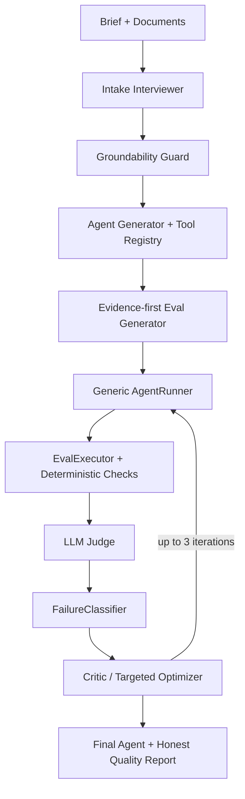

# ForgeAI — The Agent That Builds Agents

ForgeAI is **not a chatbot**. It is an agent factory: it takes a brief and a
folder of documents, builds a declarative agent, tests it against generated
evaluations, and applies bounded targeted repairs before reporting its results.

## Architecture



The interviewer identifies requirements. The Groundability Guard separately
reports what the supplied sources can and cannot support. The generated
`AgentDefinition` is declarative; `AgentRunner` executes it using shared
retrieval and registered tools, not generated Python code.

## Setup

Create and activate a virtual environment:

```bash
python -m venv .venv
```

Linux/macOS:

```bash
source .venv/bin/activate
```

Windows PowerShell:

```powershell
.venv\Scripts\Activate.ps1
```

Install ForgeAI and its declared dependencies:

```bash
pip install -e .
```

### Ollama

ForgeAI's default LLM provider is local Ollama. Install Ollama using its
official instructions, then pull the configured default model and start its
service in a separate terminal:

```bash
ollama pull qwen3:8b
ollama serve
```

The default model is `qwen3:8b`. Configure the provider/model/URL via
`FORGEAI_LLM_PROVIDER`, `FORGEAI_OLLAMA_MODEL`, and
`FORGEAI_OLLAMA_BASE_URL`; see [.env.example](./.env.example). Do not commit
`.env` or credentials.

## Run ForgeAI

```bash
python forge.py \
  --brief "I need an assistant that answers HR policy questions for shore staff." \
  --docs data/demo_hr/
```

ForgeAI may ask up to five clarifying questions. Artifacts are written below
`runs/<run-id>/` (default run ID: `generated`). To choose a run ID:

```bash
python forge.py --run-id hr_trial --brief "..." --docs data/demo_hr/
```

Each run directory is preserved; ForgeAI refuses to overwrite a non-empty run
directory.

## Run a generated agent

```bash
python run_agent.py \
  --agent runs/demo_hr/agent/final_agent.json \
  --docs data/demo_hr/
```

Ask one question and exit:

```bash
python run_agent.py \
  --agent runs/demo_hr/agent/final_agent.json \
  --docs data/demo_hr/ \
  --question "How much annual leave do full-time shore employees receive?"
```

## Demonstrations

Two generic factory demonstrations are provided:

- HR policies: [data/demo_hr/](./data/demo_hr/)
- Ship-spares procurement: [data/demo_procurement/](./data/demo_procurement/)

Run them with:

```bash
python forge.py --run-id demo_hr --brief "I need an assistant that answers HR policy questions for shore staff using our supplied company policies. It should answer concisely, cite the relevant policy, and refuse questions that require personal employee records or information not contained in the policies." --docs data/demo_hr/

python forge.py --run-id demo_procurement --brief "I need an assistant that helps procurement staff look up ship spare parts from the supplied catalogue, explain supplier/procurement rules, and calculate order totals when requested. It must not invent products, prices, stock levels, or supplier terms." --docs data/demo_procurement/
```

Actual demo scores are recorded only after a real run against the configured
LLM. Do not treat mocked tests or example files as measured demo results.

## Evaluation and optimization

The Eval Generator creates evidence-backed answerable cases plus boundary,
ambiguous, cross-document, and selected-tool cases where possible. The
EvalExecutor records actual responses. Deterministic checks enforce refusal,
source, fact, and tool-use signals; the Judge is only used for semantic
assessment that deterministic matching cannot settle.

Judge-bias mitigations:

- deterministic checks override conflicting Judge decisions
- verbosity is not rewarded
- expected facts are evaluated independently
- factual correctness and groundedness are separate dimensions
- neutral labels reduce comparison/position effects
- the Judge does not decide final pass/fail on its own

Failed cases are assigned one of `retrieval_miss`, `prompt_defect`,
`hallucination`, or `wrong_refusal`. The optimizer applies only targeted
changes, runs no more than three iterations, and preserves authoritative
unsupported/partially-supported Groundability Guard boundaries. Iteration
scorecards and agent versions are stored as artifacts.

Reports use measured results; they do not manufacture a perfect score. If
cases remain failed, the report lists them and their recorded reasons.

## Tests

```bash
pytest -q
```

## Run on unseen documents

Reviewers can test a different brief and document folder with:

```bash
python forge.py --brief "Describe the agent you need." --docs /path/to/unseen/documents/
```

## Known limitations

- Retrieval is lexical and can miss semantically related chunks.
- Local-model Judge results can vary between models and runs.
- Expected-fact validation uses semantic judgment after deterministic matching;
  it is not formal entailment verification.
- PDF page provenance can be approximate because the current loader extracts
  document text before chunking.
- The weather tool depends on availability of Open-Meteo.
